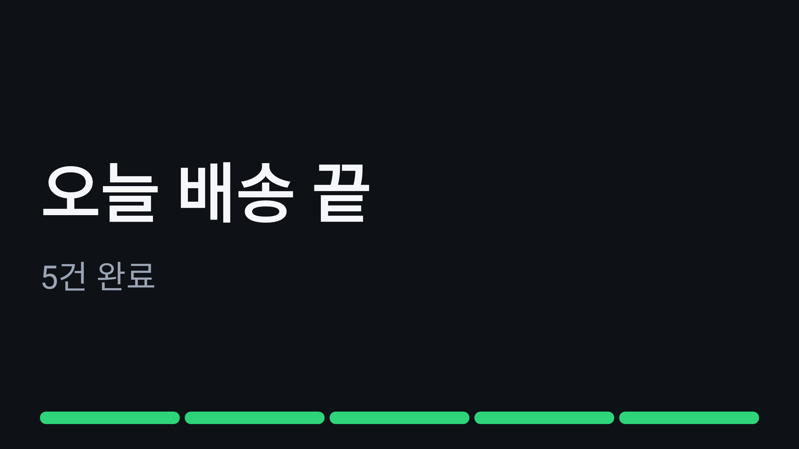
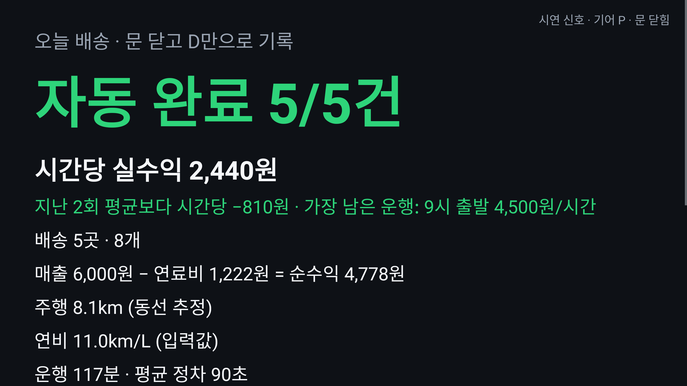

# 다음집 (next-stop)

**자기 차로 택배 부업을 하는 사람을 위한 Pleos Connect 차량용 배송 보조 앱.**
문 닫고 D를 넣으면 1건 완료, 다음 집이 내비에 뜬다.

## 심사위원용 3단계

1. **영상으로 보기** — 실제 신호 녹화(67초, 6배속·자막만 추가): [유튜브](https://www.youtube.com/watch?v=jRONe6q1r9k) · 같은 파일 [`docs/demo/video/nextstop-emulator-real-signals.mp4`](docs/demo/video/nextstop-emulator-real-signals.mp4). Pleos Connect 공식 에뮬레이터에서 Virtual Console로 기어·문을 바꾸면 자동 완료된다.
2. **기록으로 보기** — 실측·리허설을 성공·실패 그대로 모은 색인: [`docs/probe-results/INDEX.md`](docs/probe-results/INDEX.md). 리허설 숫자는 `python scripts/demo/rehearsal_stats.py`로 누구나 다시 셀 수 있다. 판정 코드 [`core/.../checkpoint/CheckpointMachine.kt`](core/src/main/kotlin/app/nextstop/core/checkpoint/CheckpointMachine.kt)와 테스트 `core/src/test`.
3. **직접 돌려 보기** — 테스트: `./gradlew :core:test :app:testDebugUnitTest`(단위 87 + 화면 16). 설치: `adb install -r apk/NextStop_다음집_release.apk` → 시연 신호 모드 `adb shell am start -n app.nextstop/.drive.DriveActivity --es mode demo`(일반 Android 기기·에뮬레이터에서도 동작, 차량 신호는 Pleos 에뮬레이터에서).

| 문제 | 다음집 |
|---|---|
| 기름값 빼면 남는 게 적다 — 어느 운행이 손해인지 끝나고 손으로 계산한다 | 차가 기록한 건수·시간·**계기판 주행거리**·연비(차가 평균 연비·전비를 주면 그 값, 없으면 입력값 — 공식 에뮬레이터는 미지원이라 입력값)로 순수익·시간당 실수익, 지난 운행과 비교(가장 남은 운행의 출발 시각) |
| 배송 기록을 손으로 따로 남긴다 | **기어 P → 1열 문 열림·닫힘 → 기어 D**를 1건 완료로 자동 기록(조수석 하차·동승 배송 포함, 설정으로 운전석만) |
| 운행 중 다음 주소를 폰·내비에 다시 넣는다 | 배송지는 출발 전 정차 중 한 번에(내비 장소 검색·최근 목적지·즐겨찾기), 운행 중에는 D 순간 다음 배송지를 Pleos 내비로 전달 |
| 배송지 순서를 머릿속으로 짠다 | 출발 전 동선 최적화(11곳까지 최적해, 그 이상 근사), 출발점은 목록 첫 곳 — 위치 권한 0 |
| 주행 중 화면 조작이 위험하다 | 주행 제한 중엔 어떤 화면이든 큰 글자 2줄, 버튼 0개, 화면 전환 0회. 정산은 정차(P)에서만 |
| 잘못 센 정차(편의점·부재) | 다음 정차(P) 때 1탭 되돌리기 — 기록·정산까지 |
| 시동을 끄면 진행 상황이 날아갈까 걱정 | 운행 상태를 기기에 저장해 그 집부터 이어감. 정차 중 헤드유닛 재시작은 문 1회로 인정 |

위치 신호 없이 **차량 신호만으로** 완료를 판정하므로 지하주차장·아파트 단지 안에서도 같은 방식으로 동작한다. 신호가 애매한 경우(신호 대기, 출발지 상차, 신호 순서 엇갈림, 창문 전달 등)의 동작은 [`docs/stop-entry.md`](docs/stop-entry.md)와 `core/src/test`의 `SignalOrderTest`·`CheckpointMachineTest`에 있다.

## 화면

JVM(Robolectric 네이티브 그래픽)에서 시연 모드 흐름을 실제로 그린 스냅샷(`DriveScreensTest`, debug 빌드라 계획 화면에 '실측 화면' 버튼이 보인다 — release APK에는 없다). 주행 중 화면 오른쪽 끝의 작은 손잡이는 시연 신호 모드에서만 보이는 '시연 전용' 조작이다.

| 계획(동선 최적화) | 주행 중(2줄) | 정차·완료 대기 |
|---|---|---|
|  |  |  |
| **D → 1건 완료, 다음 집** | 마지막 건 뒤 주행 중 | 정차(P) 후 정산 · 지난 운행 비교 |
|  |  |  |

## 실행 방법

### 요구 사항

- Android Studio(JDK 17 포함), Android SDK Platform 35
- Pleos Connect Emulator 2.1.0 이상(Virtual Console 지원), AVD **Cold Boot** 설정 — `docs/pleos/emulator.md`
- 인터넷(첫 빌드 시 Pleos Maven에서 SDK 다운로드, 토큰 불필요)

### 빌드·설치

```bash
./gradlew :core:test :app:assembleDebug
adb install -r app/build/outputs/apk/debug/app-debug.apk
```

제출용 release APK는 `apk/` 폴더에 둔다(`./gradlew :app:assembleRelease`). 디버그 키로 서명한다 — 공개 익명 저장소에 비공개 키를 넣을 수 없고, 심사위원이 같은 빌드를 재현할 수 있어야 해서다. Pleos 차량 권한은 normal 등급이라 설치만으로 허용된다(`-g`는 알림 권한만 미리 허용).

adb 시연 신호는 보내는 쪽이 `android.permission.DUMP`를 가져야 받는다(adb shell은 가짐, 일반 앱은 못 가짐).

### 실행 모드

| 모드 | 실행 | 신호 원천 |
|---|---|---|
| 차량 신호(기본) | 런처에서 '다음집' | Pleos Door + AAOS 기어 + Odometer (Virtual Console로 조작) |
| 시연 신호 | `adb shell am start -n app.nextstop/.drive.DriveActivity --es mode demo` | 화면 시연 패널(주행 중엔 '시연 전용' 손잡이로 접힘), 키보드 P·O·C·D, adb 브로드캐스트 |
| 실측 화면(debug 빌드만) | `adb shell am start -n app.nextstop/.probe.ProbeActivity --ez auto true` | 모든 SDK 호출 결과를 logcat `NSPROBE`에 기록. release APK에는 없다 |

adb로 차량 신호 흉내 내기(시연 신호 모드):

```bash
adb shell am broadcast -a app.nextstop.SIGNAL -p app.nextstop --es gear P
adb shell am broadcast -a app.nextstop.SIGNAL -p app.nextstop --es door open
adb shell am broadcast -a app.nextstop.SIGNAL -p app.nextstop --es door closed
adb shell am broadcast -a app.nextstop.SIGNAL -p app.nextstop --es gear D
```

## 테스트 환경

| 구분 | 내용 |
|---|---|
| 단위 테스트 | `core/` 순수 Kotlin 87개 — 연비·전비 고르기와 지난 운행 비교(`RunHistoryTest`), 동선 최적해, 체크포인트 판정(신호 순서 엇갈림·되돌리기·시동 끔·1열 문 묶음 `SignalOrderTest`), 기어 원천 중재, 배송지 가져오기·직접 추가, 운행 저장·복원, 정산·계기판 값 튐 방어 |
| 화면 테스트 | Robolectric 16개(+ 영상 장면 생성용 1개는 `-Dnextstop.video`일 때만) — 주행 제한 중 모든 화면 '2줄·버튼 0'(`DrivingRestrictionTest`), 정산은 P에서만, 앱 재시작 뒤 이어서 완료, 새 운행 때 배송지 정보 삭제, 완료 알림이 헤드업으로 뜨지 않음 |
| CI | GitHub Actions(`.github/workflows/`): `build`(core·화면 테스트 + debug/release APK), `emulator`(공식 에뮬레이터 실측·리허설, 결과를 `docs/probe-results/`에 커밋) |
| 에뮬레이터 실측 | 같은 스크립트를 두 곳에서: 노트북 `scripts/probe/run-probe.cmd`(Windows), GitHub Actions `emulator` 워크플로(Linux 러너에서 Pleos 공식 이미지를 창 없이 띄움 — `run-probe.ps1 -Headless`). 결과는 `docs/probe-results/` |
| 시연 영상 | 에뮬레이터 실제 신호 녹화(`emulator` 워크플로의 Virtual Console 조작, 6배속·자막 추가본 `docs/demo/video/nextstop-emulator-real-signals.mp4`) · 노트북 녹화(`scripts/demo/demo.ps1 -Record`) |
| 대상 이미지 | Pleos Connect Emulator(Android 14, 2560×1440) |

## SDK 사용 내역

자세한 클래스·메서드·권한 표: [docs/sdk-usage.md](docs/sdk-usage.md)

- **Pleos Vehicle SDK 2.3.2** — Door Position 구독(배송 체크포인트), Odometer 누적거리(실주행거리 정산), Fuel·EvBattery 평균 연비·전비(차가 주면 정산에 차 값, 공식 에뮬레이터는 미지원 응답 → 입력값)
- **Pleos NaviHelper SDK 3.0.5** — 최근 목적지·즐겨찾기로 배송지 입력, `requestRoute`로 다음 배송지 1곳씩 목적지 전달, 이벤트 수신
- **AAOS Car API** — `GEAR_SELECTION`(기어 P/D, Pleos SDK가 안내하는 경로), `CarUxRestrictions`(주행 중 화면 제한)

외부 지도·경로 API, 서버, 키를 쓰지 않는다. 샘플 배송지는 가상 좌표다.

## 구조

```
core/   순수 Kotlin 도메인 (Android 의존 없음, 단위 테스트)
  route/        동선 최적화: 11곳 이하 Held-Karp 최적해, 그 이상 최근접+2-opt+Or-opt
  checkpoint/   P → 문 사이클 → D 상태기계 (순수 함수 reduce)
  run/          운행: 차량 신호 → 상태기계 → 내비 요청·기록
  settle/       정산(시간당 실수익), 연비·전비 고르기, 지난 운행 비교, (보조) 업무용 차량 운행기록 내보내기
  display/      주행 중 2줄 문구, 완료 연출 신호
  vehicle/ nav/ 차량 신호·내비 추상화 + 목 구현
app/    Android
  platform/     Pleos Door·Odometer·Fuel·EvBattery·NaviHelper, AAOS 기어·UX 제한, adb 목 신호
  drive/        계획 → 운행 → 정산 화면, 완료 연출
  probe/        에뮬레이터 실측 화면
docs/   Pleos 문서 정리, SDK 사용 내역, 실측 순서서, 시연 대본
scripts/probe/  노트북 실측 자동화 (PowerShell)
scripts/demo/   시연 재생·녹화 보조 (PowerShell)
scripts/release/ 익명 제출용 이력 만들기·최종 점검 (bash)
```
