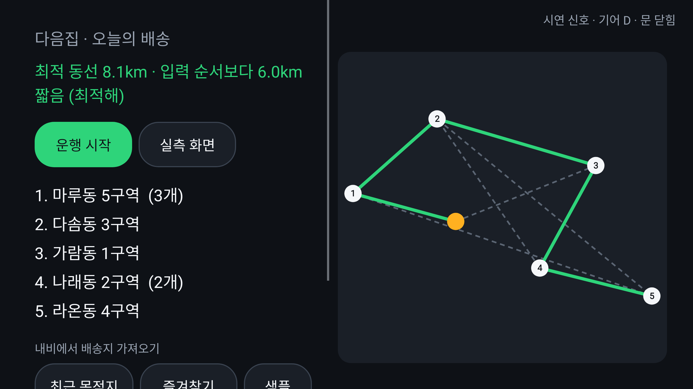
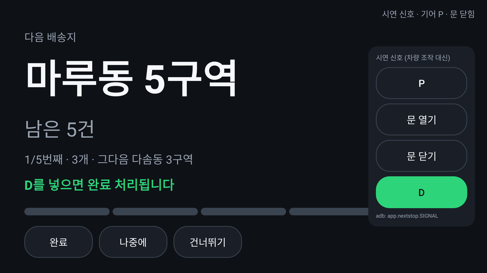
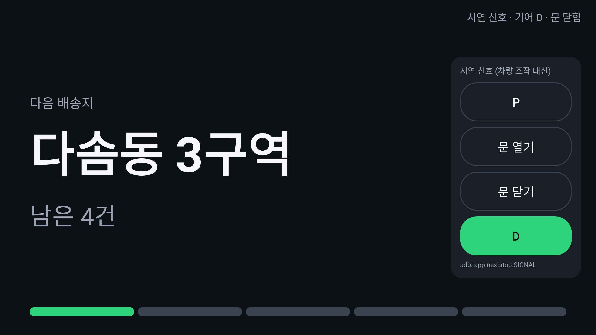
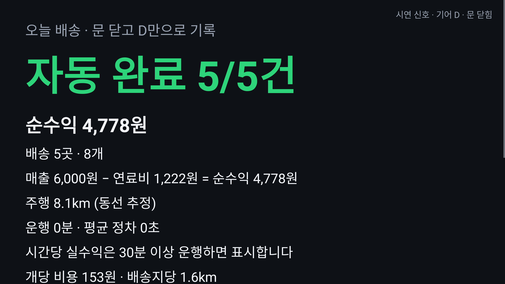

# 다음집 (next-stop)

**자기 차로 택배 부업을 하는 사람을 위한 Pleos Connect 차량용 배송 보조 앱.**
문 닫고 D를 넣으면 1건 완료, 다음 집이 내비에 뜬다.

| 문제 | 다음집 |
|---|---|
| 배송지를 내비에 하나하나 찾아 넣는다 | Pleos 내비의 **최근 목적지·즐겨찾기를 배송지로 한 번에 가져오기**(같은 건물은 합쳐 개수로) |
| 배송지 순서를 머릿속으로 짠다 | 출발 전 정차 상태에서 동선 최적화(입력 순서 대비 단축 거리 표시) |
| 매번 내비에 주소를 다시 넣는다 | 다음 배송지 1곳씩 Pleos 내비로 자동 전달 |
| 배송 완료를 폰으로 따로 체크한다 | **기어 P → 운전석 문 열림·닫힘 → 기어 D** 를 1건 완료로 자동 기록 |
| 하루 끝나고 얼마 벌었는지 모른다 | 계기판 주행거리로 연료비를 빼고 **시간당 실수익** (보조: 업무용 차량 운행기록 내보내기) |
| 주행 중 화면 조작이 위험하다 | 주행 중엔 큰 글자 2줄(다음 집·남은 건수)만, 버튼 없음. 플랫폼 주행 제한 중에는 움직이는 연출도 하지 않음 |
| 시동을 끄면 진행 상황이 날아갈까 걱정 | 운행 상태를 기기에 저장해 앱이 다시 켜져도 그 집부터 이어감 |

**▶ 시연 영상(최종본, 85초, 내레이션·음악):** [`docs/demo/video/nextstop-demo.mp4`](docs/demo/video/nextstop-demo.mp4) — 장면표 [`docs/demo/storyboard.md`](docs/demo/storyboard.md). 아래 원본은 실제 신호 동작 기록이다.

**▶ 실제 동작 원본(67초, Pleos Connect 공식 에뮬레이터 v2.1.0):** [`docs/demo/video/nextstop-emulator-real-signals.mp4`](docs/demo/video/nextstop-emulator-real-signals.mp4) — Virtual Console로 기어·운전석 문을 바꾸면 AAOS 기어·Pleos Door 신호로 3건이 자동 완료된다(실측 기록 [`docs/probe-results/ci-20261030-0347`](docs/probe-results/ci-20261030-0347)).

위치 신호 없이 **차량 신호만으로** 완료를 판정하므로 지하주차장·아파트 단지 안에서도 동작한다.
신호 대기 같은 잠깐 정차(문을 열지 않음), 출발지 상차(운행 시작 전 P·문), 문 열린 채 출발은 완료로 치지 않는다.

## 화면

JVM(Robolectric 네이티브 그래픽)에서 시연 모드 흐름을 실제로 그린 스냅샷. CI가 매 게시마다 다시 만든다.
완료 장면은 **주행 제한 중에 보이는 정적 확인 화면**이다(Pleos 설계 원칙: 주행 중 움직이는 이미지 금지). 정차 상태로 확인될 때만 플래시·카운트 상승·카드 슬라이드 애니메이션으로 재생된다.

| 계획(동선 최적화) | 주행 중(2줄) | 정차·완료 대기 |
|---|---|---|
|  |  |  |
| **D → 1건 완료** | 다음 집 등장 | 정산 |
|  |  |  |

## 실행 방법

### 요구 사항

- Android Studio(JDK 17 포함), Android SDK Platform 35
- Pleos Connect Emulator 2.1.0 이상(Virtual Console 지원), AVD **Cold Boot** 설정 — `docs/pleos/emulator.md`
- 인터넷(첫 빌드 시 Pleos Maven에서 SDK 다운로드, 토큰 불필요)

### 빌드·설치

```bash
./gradlew :core:test :app:assembleDebug
adb install -r app/build/outputs/apk/debug/app-debug.apk
```

**제출 APK: [`apk/NextStop_다음집_release.apk`](apk/NextStop_다음집_release.apk)** (release 빌드, 심사 설치용 디버그 키 서명 · 해시 `apk/NextStop_다음집_release.apk.sha256`).

```bash
adb install -r -g apk/NextStop_다음집_release.apk
```

### 실행 모드

| 모드 | 실행 | 신호 원천 |
|---|---|---|
| 차량 신호(기본) | 런처에서 '다음집' | Pleos Door + AAOS 기어 + Odometer (Virtual Console로 조작) |
| 시연 신호 | `adb shell am start -n app.nextstop/.drive.DriveActivity --es mode demo` | 화면 시연 패널 또는 adb 브로드캐스트 |
| 실측 화면 | `adb shell am start -n app.nextstop/.probe.ProbeActivity --ez auto true` | 모든 SDK 호출 결과를 logcat `NSPROBE`에 기록 |

adb로 차량 신호 흉내 내기(시연 신호 모드):

```bash
adb shell am broadcast -a app.nextstop.SIGNAL -p app.nextstop --es gear P
adb shell am broadcast -a app.nextstop.SIGNAL -p app.nextstop --es door open
adb shell am broadcast -a app.nextstop.SIGNAL -p app.nextstop --es door closed
adb shell am broadcast -a app.nextstop.SIGNAL -p app.nextstop --es gear D
```

## 테스트 환경

| 구분 | 내용 |
|---|---|
| 단위 테스트 | `core/` 순수 Kotlin 72개(동선 최적해 검증, 체크포인트 오탐 방지, 기어 원천 중재, 배송지 가져오기·직접 추가, 운행 저장·복원, 정산·운행기록·계기판 값 튐 방어) — `./gradlew -Pnextstop.coreOnly=true :core:test` |
| 화면 테스트 | Robolectric로 실제 화면 렌더링(시연 흐름 7장면), 주행 중 버튼 숨김, 앱 재시작 후 이어서 완료, 내비가 앱을 덮은 동안 완료 알림, 배송지 편집(삭제·순서 고정)이 앱 재시작 뒤에도 남음 |
| CI | GitHub Actions: core·화면 테스트 + Pleos SDK를 받아 debug/release APK 빌드 |
| 에뮬레이터 실측 | 같은 스크립트를 두 곳에서: 노트북 `scripts/probe/run-probe.cmd`(Windows), GitHub Actions `emulator` 워크플로(Linux 러너에서 Pleos 공식 이미지를 창 없이 띄움 — `run-probe.ps1 -Headless`). 결과는 `docs/probe-results/` |
| 시연 영상 | 최종본 `docs/demo/video/nextstop-demo.mp4`(85초, 내레이션·음악, 장면표 `docs/demo/storyboard.md`) · 에뮬레이터 실제 신호 녹화(CI `emulator` 워크플로의 Virtual Console 조작, 자막본 `docs/demo/video/nextstop-emulator-real-signals.mp4`) · 노트북 녹화(`scripts/demo/demo.ps1 -Record`) · 예비본: 화면 테스트 장면 + 자막(`video` 워크플로) |
| 대상 이미지 | Pleos Connect Emulator(Android 14, 2560×1440) |

## SDK 사용 내역

자세한 클래스·메서드·권한 표: [docs/sdk-usage.md](docs/sdk-usage.md)

- **Pleos Vehicle SDK 2.3.2** — Door Position 구독(배송 체크포인트), Odometer 누적거리(실주행거리 정산)
- **Pleos NaviHelper SDK 3.0.5** — 최근 목적지·즐겨찾기로 배송지 입력, `requestRoute`로 다음 배송지 1곳씩 목적지 전달, 이벤트 수신
- **AAOS Car API** — `GEAR_SELECTION`(기어 P/D, Pleos SDK가 안내하는 경로), `CarUxRestrictions`(주행 중 화면 제한)

외부 지도·경로 API, 서버, 키를 쓰지 않는다. 샘플 배송지는 가상 좌표다.

## 구조

```
core/   순수 Kotlin 도메인 (Android 의존 없음, 단위 테스트)
  route/        동선 최적화: 11곳 이하 Held-Karp 최적해, 그 이상 최근접+2-opt+Or-opt
  checkpoint/   P → 문 사이클 → D 상태기계 (순수 함수 reduce)
  run/          운행: 차량 신호 → 상태기계 → 내비 요청·기록
  settle/       정산(시간당 실수익), (보조) 업무용 차량 운행기록 내보내기
  display/      주행 중 2줄 문구, 완료 연출 신호
  vehicle/ nav/ 차량 신호·내비 추상화 + 목 구현
app/    Android
  platform/     Pleos Door·Odometer·NaviHelper, AAOS 기어·UX 제한, adb 목 신호
  drive/        계획 → 운행 → 정산 화면, 완료 연출
  probe/        에뮬레이터 실측 화면
docs/   Pleos 문서 정리, SDK 사용 내역, 실측 순서서, 시연 대본
scripts/probe/  노트북 실측 자동화 (PowerShell)
scripts/demo/   시연 재생·녹화 보조 (PowerShell)
scripts/release/ 익명 제출용 이력 만들기·최종 점검 (bash)
```
